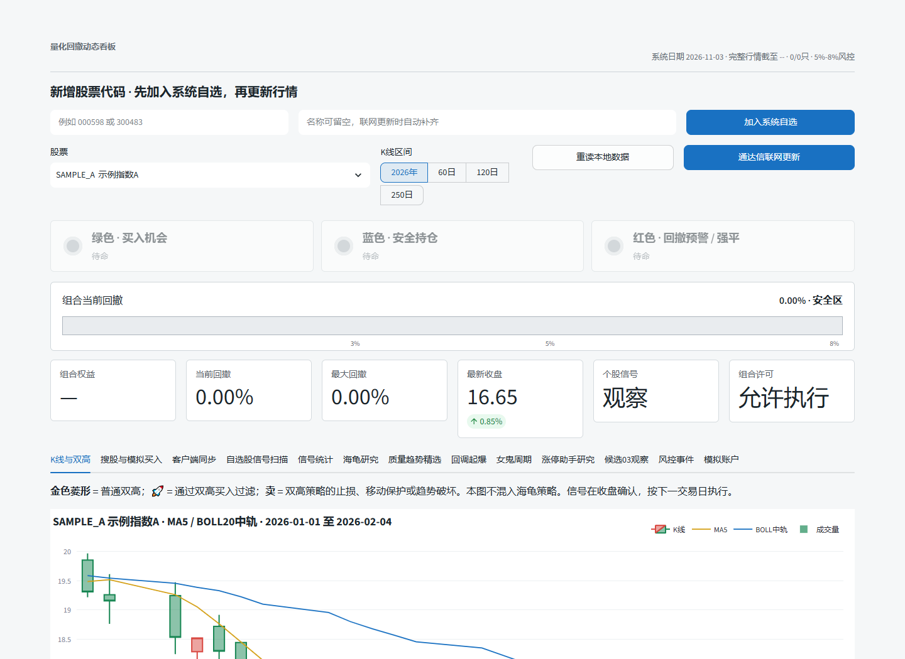

# TZHC A-Share Index & Drawdown Analysis System

[](https://github.com/Li-AmG/tzhc-index-analysis/actions/workflows/tests.yml)
[](LICENSE)

一个面向中国大陆 A 股研究场景的开源指数、信号、回撤与模拟交易分析系统。项目提供 Streamlit 可视化看板、桌面界面、回测引擎、策略研究模块、审计记录和纸面交易账户。

> 本仓库是研究与教育工具，不提供投资建议，不保证收益，也不连接券商执行真实交易。示例行情为合成数据。

## 界面预览



<details>
<summary>查看动态演示 GIF</summary>


</details>

## 主要能力

- **大陆市场规则**：支持 100 股一手、佣金最低收费、卖出印花税、滑点与不同板块涨跌停参数。
- **指数与市场环境**：内置上证指数、深证成指、创业板指、科创 50 基准定义。
- **回撤控制**：默认 5% 软锁定、8% 硬熔断，可在配置中调整。
- **策略研究**：均线、突破、回调点火、生命周期、海龟与反转、涨停辅助等模块。
- **信号分析**：信号扫描、前向收益统计、组合回测和结果导出。
- **模拟账户**：纸面持仓、待执行信号、风险锁定、交易记录和净值记录。
- **可视化**：Streamlit 中文看板和 Tkinter 桌面入口。
- **测试**：覆盖回测、市场数据标准化、策略、模拟账户、客户端自选股和审计链。

## 快速开始

需要 Python 3.11 或更高版本。

```bash
python -m venv .venv
```

Windows：

```powershell
.\.venv\Scripts\Activate.ps1
python -m pip install -r requirements-dashboard.txt
streamlit run tzhc_streamlit.py
```

macOS / Linux：

```bash
source .venv/bin/activate
python -m pip install -r requirements-dashboard.txt
streamlit run tzhc_streamlit.py
```

仓库自带少量合成行情与演示自选股，因此无需下载真实行情即可浏览界面和运行测试。

## 运行测试

```bash
python -m unittest discover -v
```

## 可选：只读行情更新

`tzhc_market.py` 可以通过 `pytdx` 读取公开行情接口。该依赖已经停止维护，因此不作为默认安装项：

```bash
python -m pip install -r requirements-market.txt
```

请自行确认数据源的服务条款、稳定性和适用范围。不要把付费数据、账号凭据、Cookie 或访问令牌提交到仓库。

## 数据格式

行情 CSV 至少需要以下字段：

```text
date,symbol,open,high,low,close,volume
```

真实数据文件默认放在 `data/`，该目录中的非示例文件会被 Git 忽略。

## 配置

主要参数位于 [`config/settings.json`](config/settings.json)，包括：

- 初始资金、最大持仓数和单票仓位；
- 止损、止盈、移动止盈和回撤阈值；
- 手数、佣金、最低佣金、印花税和滑点；
- 均线、突破、量比及不同策略参数。

## 隐私与公开范围

原始工作目录包含多年行情缓存、回测输出、录音、截图、浏览器数据和本地虚拟环境。这些内容均未进入本仓库。公开版本只包含源码、测试、配置和合成示例数据。

## 已知限制

- 交易日判断目前主要处理周末，没有内置完整中国交易所节假日日历。
- 实时行情和客户端桥接依赖本地环境及第三方数据源。
- 示例结果不能外推为真实市场表现；回测不代表未来收益。
- Windows 客户端发现和部分桌面功能在其他操作系统上不可用。

## License

源代码采用 [MIT License](LICENSE)。第三方数据、第三方软件和用户自行导入的文件不因本许可证而获得授权。

## English summary

TZHC is an open-source research dashboard and backtesting toolkit for mainland China A-share workflows. It includes configurable market rules, drawdown controls, multiple signal/strategy modules, paper trading, audit logs, a Streamlit dashboard, and synthetic demo data. It is for research and education only—not investment advice or an execution system.
